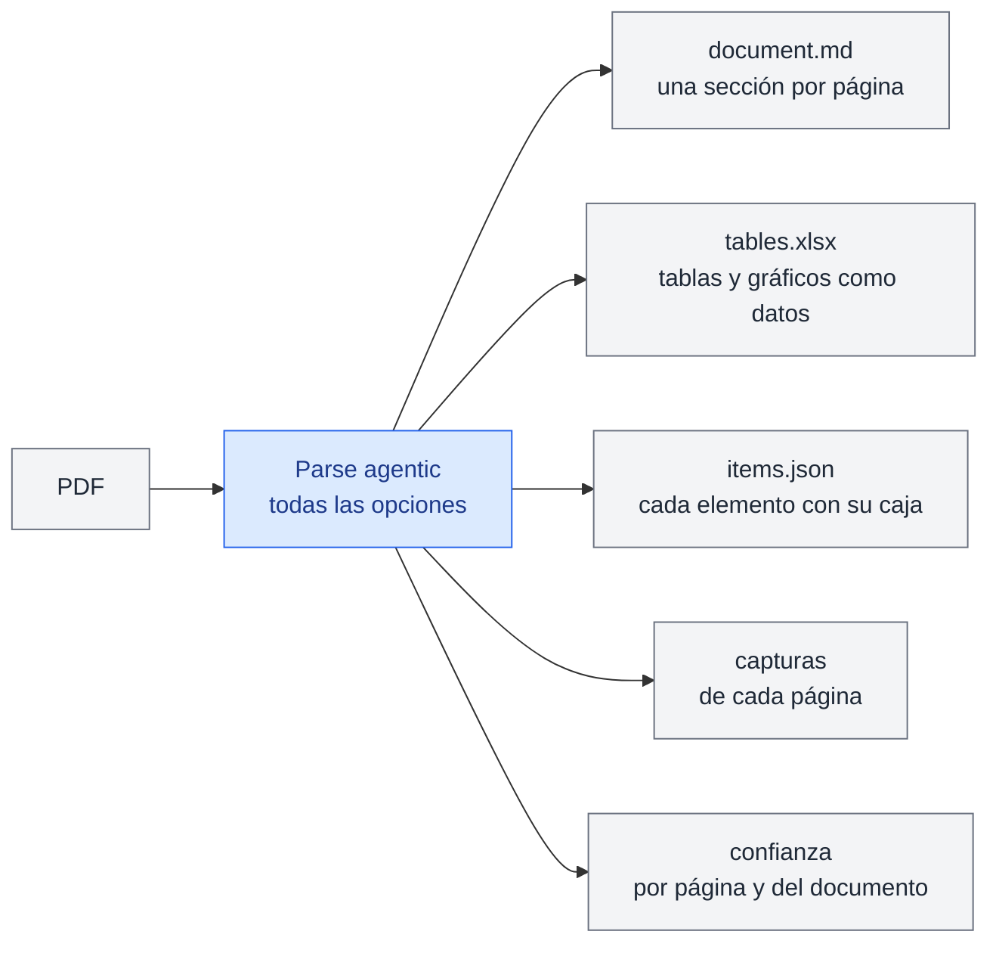
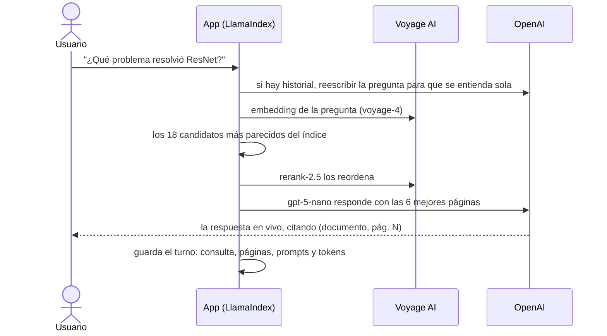
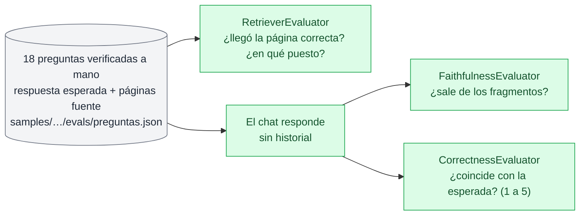
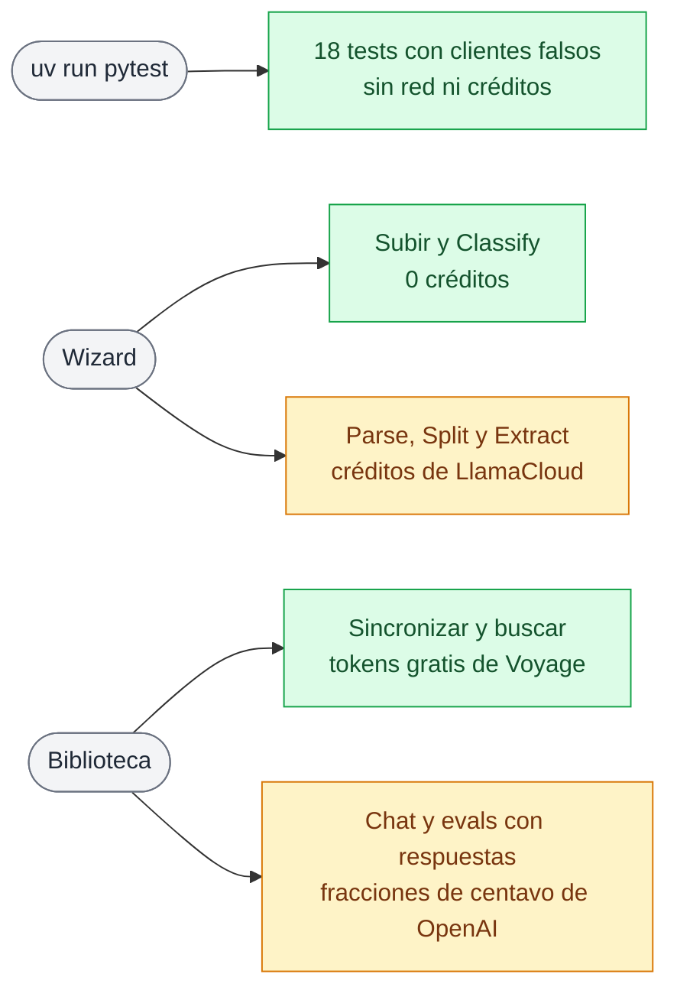
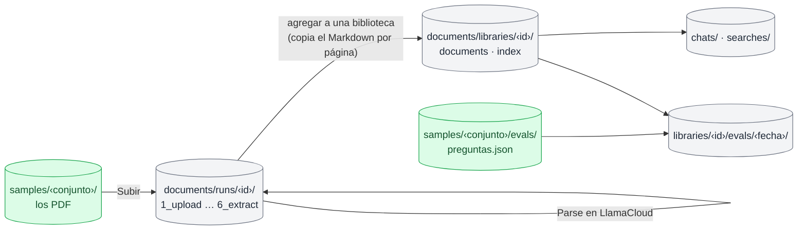

# Parla RAG

**Documentos que se leen solos, y una conversación con todos a la vez.**

Una app web que recorre un documento **paso por paso** con LlamaCloud (leerlo, partirlo, clasificarlo y sacarle los datos) y después junta varios documentos en una **biblioteca** para buscar y **chatear** con todos a la vez, con LlamaIndex, Voyage AI y OpenAI. Cada paso muestra qué se le pidió a la plataforma, qué devolvió, cuánto costó y qué significa, y cada respuesta del chat cita documento y página.

**La idea, en una línea:** no alcanza con que la IA responda; hay que poder **ver de dónde sale cada dato**, **medir** si está bien y **explicar** cada decisión con números.

| | |
|---|---|
| **Tipo** | Proyecto personal, académico y de portfolio |
| **Autor** | Rodolfo Javier Berrone |
| **Año** | 2026 |
| **Documentos de prueba** | El material teórico de la materia **Aprendizaje Automático II**: 14 PDF de diapositivas, 410 páginas (redes neuronales, PLN, visión por computadora, modelos multimodales y sesgo) |
| **Estado** | El wizard y las bibliotecas funcionan y están medidos. Lo pendiente está en [docs/estado.md](docs/estado.md) |


[](LICENSE)

## Contenido

- [El proyecto en números](#el-proyecto-en-números)
- [Cómo funciona](#cómo-funciona)
- [1. Los documentos](#1-los-documentos)
- [2. Parse: el corazón](#2-parse-el-corazón)
- [3. Split, Classify, Schema y Extract](#3-split-classify-schema-y-extract)
- [4. Bibliotecas: quién hace qué](#4-bibliotecas-quién-hace-qué)
- [La página principal: el chat](#la-página-principal-el-chat)
- [5. Evals: medir la búsqueda y las respuestas](#5-evals-medir-la-búsqueda-y-las-respuestas)
- [Qué aprendimos](#qué-aprendimos)
- [Costos medidos](#costos-medidos)
- [Las reglas del proyecto](#las-reglas-del-proyecto)
- [Reproducir](#reproducir)
- [Estructura del repositorio](#estructura-del-repositorio)
- [La API, ruta por ruta](#la-api-ruta-por-ruta)
- [La documentación](#la-documentación)
- [Glosario rápido](#glosario-rápido)
- [Créditos](#créditos)
- [Licencia](#licencia)

## El proyecto en números

| | |
|---|---|
| Páginas parseadas | **410**, de 14 PDF, en un lote de 84 s |
| Créditos de LlamaCloud | **7.250** (17,7 por página en promedio) |
| Biblioteca | 410 páginas, una por chunk, sincronizada en 6 s y sin créditos |
| Búsqueda (31 preguntas verificadas, varias cruzan clases) | hit rate **1,0** · MRR **0,96** · cobertura de clases **0,966** |
| Respuestas | entre **22 y 25 de 31 correctas** según la corrida (el juez tiene ruido) y **30 de 31 fieles** a los fragmentos |
| Tiempo por respuesta | **2,7 s** en promedio (4,2 s la más lenta) |
| Costo de una pregunta en el chat | unos **USD 0,0003** de OpenAI (estimado con su lista de precios) y 0 créditos de LlamaCloud |

El número que más enseña no está en la tabla: **el chat responde bien, pero a veces cita mal**. En dos preguntas dio el contenido correcto con la página o el nombre del documento equivocados. Por eso cada respuesta muestra las páginas que se buscaron: la cita se puede comprobar, no hay que creerle. Está explicado en la [sección 5](#5-evals-medir-la-búsqueda-y-las-respuestas).

## Cómo funciona


**Los colores dicen quién hace cada cosa** (el mismo código en todos los diagramas):
🔵 LlamaCloud (en la nube, con créditos) · 🟢 LlamaIndex (código abierto, en nuestro servidor) · 🟣 Voyage AI (embeddings y reranker) · 🌸 OpenAI (el modelo que escribe) · ⚪ nuestro código y los datos.

| Etapa | Pregunta que responde | Resultado |
|---|---|---|
| **1. Documentos** | ¿Con qué probamos? | 14 PDF de diapositivas: 410 páginas con gráficos, tablas, código y fórmulas |
| **2. Parse** | ¿Cómo se lee un PDF? | Markdown, tablas, gráficos como tablas, diagramas como Mermaid, cajas por elemento y capturas |
| **3. Split → Extract** | ¿Qué es y qué datos tiene? | Tipo con confianza y razonamiento; datos con cita y caja en la página |
| **4. Biblioteca y chat** | ¿Cómo se conversa con varios documentos? | LlamaIndex arma el índice y el chat; Voyage busca; OpenAI responde citando |
| **5. Evals** | ¿Cómo sabemos que está bien? | Búsqueda perfecta en las 18 preguntas; 15 de 18 respuestas correctas |

## 1. Los documentos

El material teórico de **Aprendizaje Automático II**, una carpeta por clase, en [`backend/data/samples/aprendizaje-automatico-ii/`](backend/data/samples/aprendizaje-automatico-ii/). Las clases cuentan una historia de punta a punta, así que el chat puede cruzarlas.

| Clase | Páginas | Créditos | Confianza del parse |
|---|---|---|---|
| 00 Presentación de la materia | 15 | 225 | 99 % |
| 01 Introducción a redes neuronales | 11 | 265 | 90 % |
| 02 Perceptrón multicapa y deep learning | 9 | 155 | 85 % |
| 03 PLN: conceptos y técnicas | 45 | 715 | 88 % |
| 04 PLN: modelos estadísticos y representaciones vectoriales | 32 | 720 | 94 % |
| 05 PLN: redes neuronales (RNN, Transformers, RAG) | 28 | 460 | 79 % |
| 06 Procesamiento digital de imágenes | 40 | 600 | 95 % |
| 07 Clasificación de imágenes (CNN) | 36 | 620 | 94 % |
| 08 Transferencia de aprendizaje | 24 | 360 | 92 % |
| 09 Detección de objetos | 41 | 1.035 | 78 % |
| 10 Segmentación de imágenes | 26 | 390 | 88 % |
| 11 Generación de imágenes | 34 | 550 | 92 % |
| 12 Modelos multimodales | 33 | 615 | 94 % |
| 13 Sesgo, ética y evaluación robusta | 36 | 540 | 98 % |
| **Total** | **410** | **7.250** | |

**Las notebooks no se parsean.** Cada clase tiene sus notebooks de práctica (32 en total), pero LlamaParse no acepta `.ipynb` ([lista oficial de formatos](https://developers.llamaindex.ai/llamaparse/general/supported_document_types/)) y la teoría está en los PDF. Si hicieran falta, LlamaIndex tiene un lector nativo (`IPYNBReader`) que las carga sin pasar por LlamaCloud.

## 2. Parse: el corazón

Se parsea **una vez**, completo, con todas las opciones y salidas. Split, Classify, Extract y las bibliotecas usan ese parse (`pjb-…`) y no vuelven a leer el documento.



**Lo que se vio con las diapositivas:**
- **Los diagramas salen como Mermaid** (el bloque residual de ResNet, la arquitectura de U-Net, el proceso de RAG) y **los gráficos, como tablas de datos** (la curva precisión-recall de la clase 09, el histograma de la umbralización).
- **El costo depende de las imágenes:** de 15 a 25 créditos por página. La más cara fue `09 Detección de objetos`, llena de imágenes con cajas. La API no desglosa el costo por página.
- **La confianza marca qué revisar, pero no dice por qué:** la clase 02 tiene la pág. 6 con 30 % de confianza. Hay que comparar la captura con el Markdown.
- **Las tablas que siguen en la página siguiente las une LlamaParse** (`merge_continued_tables`) y quedan enteras en su primera página.

## 3. Split, Classify, Schema y Extract

Los cuatro pasos usan el parse ya hecho, así que no lo vuelven a pagar:

| Paso | Qué hace | Créditos |
|---|---|---|
| **Split** | Divide en partes según categorías editables | No los informa (la lista de precios dice 3 por página) |
| **Classify** | Elige el tipo con reglas editables, con confianza y razonamiento | **0** sobre un parse |
| **Schema** | Manual (tabla, plantilla o JSON) o automático (`generate_schema`); se valida y se guarda como configuración | No los informa |
| **Extract** | Saca cada dato con su cita, su caja en la página y su confianza | **15 por página** |

**Lo que hay que saber de Extract:**
- **Un campo obligatorio obliga a Extract a devolver algo, aunque no exista.** Por eso el wizard trae la opción **"solo identidad obligatoria"** y avisa cuando todos los campos son obligatorios.
- **Una cita válida y una confianza alta no garantizan el dato.** Lo que sirve es **ver la caja sobre la captura**: el wizard las dibuja en verde o en rojo según la confianza.

## 4. Bibliotecas: quién hace qué



- **Motor local** (`local_library.py`, el que se usa): el **framework LlamaIndex** arma el índice y el chat (`CondensePlusContextChatEngine`) en nuestro servidor, con las integraciones oficiales de Voyage AI y OpenAI. Se usa porque el índice de LlamaCloud necesita un plan pago (con el plan gratis responde 403).
- **Motor de LlamaCloud** (`library.py`): escrito y probado con el cliente falso; queda para cuando haya plan.
- **Una página = un chunk** (`LIBRARY_SPLITTER=pagina`, por defecto). Se compararon los tres cortes nativos de LlamaIndex (`SentenceSplitter`, `MarkdownNodeParser` y página entera) y ganó el más simple: no separa una tabla de su encabezado, respeta las tablas que ya unió LlamaParse y deja la cita exacta. Las diapositivas son cortas, así que una página entra entera.
- **El modelo:** `gpt-5-nano`, el más barato de OpenAI ([precios](https://developers.openai.com/api/docs/pricing)), con `reasoning_effort=minimal` para que casi no razone: el razonamiento se cobra como tokens de salida.
- **Las instrucciones** piden responder solo con los fragmentos, decir que el dato no está cuando no está, citar *(documento, pág. N)* y copiar los números tal cual.

## La página principal: el chat

La app abre en la pestaña **Chat**: se le pregunta a las 14 clases a la vez.

- **El recorrido, fijo arriba:** cinco cajas con los mismos colores de los diagramas (los PDF → Parse → 1 página = 1 chunk → Voyage AI → OpenAI). Cada caja se abre con qué hace y por qué se eligió, y muestra números reales de la API (páginas, créditos, chunks, modelos).
- **Pestañas de conversación:** cada una tiene su historial (el chat lo usa para entender las preguntas de seguimiento). Cerrar una solo la oculta: queda en disco para auditar.
- **Filtros por unidad y por clase**, apagados por defecto. Las unidades salen de **Classify**, con las 4 unidades del programa como reglas: las 14 clases quedaron bien ubicadas, sin créditos.
- **Citas agrupadas por clase:** cada página citada se abre con su captura de Parse y su texto, para comprobar la cita.
- **Detrás de escena** de cada respuesta: ① la búsqueda (candidatos y modo), ② el reranker (las páginas elegidas con su puntaje) y ③ la respuesta (modelo, tokens y costo **estimado**).

El guion para mostrarlo en clase está en [docs/guion-demo.md](docs/guion-demo.md).

## 5. Evals: medir la búsqueda y las respuestas

Todo es **nativo de LlamaIndex** (`llama_index.core.evaluation`). LlamaCloud y Voyage AI no tienen un producto de evals propio.



**El set:** 16 preguntas con fuente (datos, explicaciones y comparaciones de 11 clases) y 2 **trampas**: *"¿Cómo funciona Q-learning?"* (aprendizaje por refuerzo no se da en la materia) y *"¿En qué fecha es el primer parcial?"* (la presentación nombra los parciales sin fecha). Cada respuesta esperada sale del parse, y si un dato aparece en varias páginas, todas cuentan como fuente.

| Métrica | Resultado |
|---|---|
| Búsqueda: hit rate | **1,0** (en las 16 preguntas con fuente llega una página correcta) |
| Búsqueda: MRR | **1,0** (la primera página que llega siempre es correcta) |
| Respuestas fieles a los fragmentos | **17 de 18** |
| Respuestas correctas (4 o más de 5) | **15 de 18** |

**Las tres "incorrectas", leídas una por una:**
1. **U-Net:** respondió para qué surgió (imágenes médicas con pocos ejemplos) pero no dónde ni cuándo (Freiburg, 2015), aunque estaba en la misma página. **Falla real: respuesta incompleta.**
2. **El ejemplo de equidad:** el contenido es correcto (cumple solo la paridad predictiva), pero **citó la pág. 17 en lugar de la 21**. Falla de cita.
3. **La trampa de Q-learning:** el chat hizo lo correcto (dijo que no está en los documentos) y **el juez lo penalizó** por no explicar el tema. Es un error del juez.

Además, en una respuesta que el juez dio por buena, el chat citó *"04 CLIP: arquitectura"* en lugar de *"12 Modelos multimodales.pdf"*. **Con un modelo tan chico, el contenido es bueno, pero las citas no son confiables.**

**El set ampliado (21/11):** 31 preguntas (29 con fuente y 2 trampas), con preguntas parafraseadas y que cruzan clases. Suma la **cobertura de clases** (en las preguntas que cruzan clases, cuántas de las clases correctas llegaron al modelo) y el **tiempo por respuesta**. Con la configuración elegida (6 páginas, búsqueda `default`): hit rate 1,0 · MRR 0,96 · cobertura 0,966 · 24 de 31 correctas · 2,7 s por respuesta. Se probaron 12 páginas y MMR: **ninguno mejoró la cobertura** y MMR tardó casi el doble. Corriendo la misma configuración varias veces, el juez da entre 22 y 25 correctas: una diferencia más chica que eso no alcanza para elegir. El detalle está en la [bitácora](docs/bitacora.md).

> **Ojo con leer el 1,0 de la búsqueda como definitivo.** Las preguntas se armaron mirando los títulos de las diapositivas y usan casi las mismas palabras. Mide que la búsqueda encuentra lo que está escrito, no que entienda una pregunta formulada de otra manera. El paso siguiente son preguntas parafraseadas y que crucen clases.

## Qué aprendimos

1. **El parse es el corazón.** Se parsea una vez, completo, y todo lo demás sale de ahí. Pero no es determinístico: los datos de gráficos hay que verificarlos contra la captura.
2. **Medir antes de gastar.** Una clase de 9 páginas (155 créditos) dio el costo por página, y con eso la estimación del lote: se calcularon unos 7.000 y fueron 7.250.
3. **Una cita válida no garantiza el dato**, y una respuesta correcta no garantiza la cita. Lo que sirve es **ver la página**.
4. **Los campos obligatorios hacen inventar.** Con pocos obligatorios y la regla "vacío si no consta", Extract no inventa.
5. **Lo más simple ganó en el corte:** una página = un chunk.
6. **El juez también se equivoca.** Penalizó una trampa bien respondida y dejó pasar una cita mal armada. Sus explicaciones hay que leerlas.
7. **El set también se audita:** un eval perfecto puede decir más del set que del sistema.

## Costos medidos

| Qué | Costo | Cómo se midió |
|---|---|---|
| Parse agentic con todas las opciones | 15 a 25 créditos por página (17,7 en promedio en las diapositivas) | `usage` de cada job |
| Split | No lo informa; la lista de precios dice 3 por página | — |
| Classify sobre un parse ya hecho | 0 | `expand=usage` |
| Schema (`generate_schema`, validar, guardar) | No lo informa | Conciliación con el panel |
| Extract agentic con citas y confianza | 15 créditos por página, sin importar cuántos campos | `extract_credits` |
| Índice de una biblioteca | 0 créditos; tokens de Voyage (gratis hasta 200 millones) | — |
| Una corrida de evals con respuestas (18 preguntas) | 0 créditos; unos USD 0,006 de OpenAI (82.396 tokens de entrada y 5.225 de salida) | `usage` de OpenAI y la lista de precios |

Cada llamada paga está en el **registro de créditos** de la [bitácora](docs/bitacora.md), con su job, sus opciones y lo que costó.

## Las reglas del proyecto

1. **Solo lo nativo.** Nada que LlamaCloud, LlamaParse o LlamaIndex (con sus integraciones oficiales) no hagan de forma nativa. Si la plataforma no lo hace, se dice y se decide.
2. **Traer todo, medir e interpretar.** Cada paso pide toda la información, la guarda (`request.json`, `response.json`), la mide y la interpreta **solo con datos de la API**. Si la API no dice el motivo de algo, se dice así.
3. **Registrar todo para auditar.** Cada prueba, hallazgo y decisión va a la bitácora, en orden.
4. **Código simple**, con un comentario en español arriba de cada función que dice qué hace y por qué.
5. **Sin base de datos:** todo en carpetas, y **cada cosa en su carpeta**.

Las reglas completas están en [CLAUDE.md](CLAUDE.md).

## Reproducir

**Lo que hace falta:** Python 3.11 con [`uv`](https://docs.astral.sh/uv/), Node.js y tres claves.

```bash
git clone https://github.com/javi2481/parla-rag.git
cd parla-rag/backend
cp .env.example .env      # completar las tres claves
uv sync
uv run uvicorn app.main:app --reload --port 8000

# en otra terminal (el proxy de Vite manda /api al backend)
cd frontend && npm install && npm run dev      # http://localhost:5173
```

| Clave | Para qué | Dónde se saca |
|---|---|---|
| `LLAMA_CLOUD_API_KEY` | El wizard | [cloud.llamaindex.ai](https://cloud.llamaindex.ai) |
| `VOYAGE_API_KEY` | Embeddings y reranker | [dashboard.voyageai.com](https://dashboard.voyageai.com). **Cargá un medio de pago:** sin tarjeta permite 3 pedidos y 10.000 tokens por minuto (los 200 millones gratis se mantienen) |
| `OPENAI_API_KEY` | El chat y el juez de los evals | [platform.openai.com](https://platform.openai.com) |



**Con Docker** (un solo contenedor: compila el frontend y lo sirve FastAPI junto con la API):

```bash
docker compose up --build -d     # http://localhost:8000
```

Las claves se leen de `backend/.env` al arrancar y nunca entran en la imagen; los datos quedan en el volumen `parla-rag-data`. La primera sincronización baja los datos de NLTK (necesita internet). Si la cuenta de LlamaCloud es de la región EU: `LLAMA_CLOUD_BASE_URL=https://api.cloud.eu.llamaindex.ai`.

**Las opciones de las bibliotecas** (en `.env`, todas con valor por defecto): `LIBRARY_ENGINE=local`, `LIBRARY_SPLITTER=pagina`, `LIBRARY_EMBED_MODEL=voyage-4`, `LIBRARY_RERANK_MODEL=rerank-2.5`, `LIBRARY_CHAT_MODEL=gpt-5-nano`, `LIBRARY_REASONING_EFFORT=minimal` y `LIBRARY_CHAT_TOP_K=6`.

## Estructura del repositorio

```text
.
├── backend/
│   ├── app/
│   │   ├── main.py                    # arma la app y conecta las rutas
│   │   ├── core/                      # lo compartido: configuración, límites y runs/ (la carpeta-DB)
│   │   └── pipelines/documents/       # todo el pipeline (ver su README)
│   │       ├── pipeline.py            # el orden de los pasos: empezá a leer por acá
│   │       ├── steps/                 # un archivo por paso del wizard
│   │       ├── local_library.py       # bibliotecas con LlamaIndex + Voyage + OpenAI (el motor que se usa)
│   │       ├── library_evals.py       # evals de las bibliotecas
│   │       └── library.py             # bibliotecas con el índice de LlamaCloud (plan pago)
│   ├── data/                          # la "base de datos" en carpetas
│   │   ├── samples/                   # los documentos de ejemplo y el set de evals de cada conjunto
│   │   ├── documents/runs/            # las corridas del wizard (no van al repo)
│   │   ├── documents/libraries/       # las bibliotecas: índice, chats, búsquedas y evals (no van al repo)
│   │   └── nltk/                      # datos para cortar oraciones (se bajan solos)
│   └── tests/                         # misma forma que app/
├── frontend/src/
│   ├── components/                    # wizard (stepper, visores, cajas sobre la página) y ui/
│   └── pipelines/documents/           # el chat (la página principal), el wizard, un panel por paso y las bibliotecas
├── docs/
│   ├── estado.md                      # hecho, pendiente y roadmap
│   ├── bitacora.md                    # cada prueba, hallazgo y decisión, con el registro de créditos
│   └── …                              # el plan y el informe de la API
├── CLAUDE.md                          # las reglas del proyecto
└── LICENSE
```

Cómo viajan los datos entre las carpetas:



🟢 en el repo · ⚪ solo en la máquina (pesan mucho y traen links firmados temporales). **Fuente de verdad:** los números de este README salen de las corridas guardadas y están anotados en la bitácora.

## La API, ruta por ruta

| Ruta | Qué hace | Escribe en | Costo |
|---|---|---|---|
| `POST /api/documents/runs` | Crea una corrida y sube el archivo | `runs/‹id›/1_upload/` | 0 |
| `POST /api/documents/runs/{id}/steps/{paso}` | Arranca un paso (`parse`, `split`, `classify`, `schema`, `extract`) | `runs/‹id›/‹n›_‹paso›/` | Créditos según el paso |
| `GET /api/documents/runs/{id}/steps/{paso}` | Consulta el job y, al terminar, guarda todo | ídem | 0 |
| `DELETE /api/documents/runs/{id}` | Borra la corrida, su archivo y todos sus jobs en LlamaCloud | — | 0 |
| `POST /api/documents/libraries` | Crea una biblioteca | `libraries/‹id›/run.json` | 0 |
| `POST /api/documents/libraries/{id}/documents` | Agrega una corrida (copia su Markdown por página) | `documents/` | 0 |
| `POST /api/documents/libraries/{id}/sync` | Arma el índice | `index/` · `syncs/` | Tokens de Voyage |
| `POST /api/documents/libraries/{id}/search` | Búsqueda de prueba, con filtros por metadata | `searches/` | Tokens de Voyage |
| `POST /api/documents/libraries/{id}/chat` | Un turno de chat, en vivo (`conversation_id`, `filters`) | `chats/local/‹conversación›/` | Fracciones de centavo de OpenAI |
| `GET` / `POST /api/documents/libraries/{id}/conversations` | Las conversaciones abiertas · crea una vacía | `chats/local/‹conversación›/` | 0 |
| `GET /api/documents/libraries/{id}/conversations/{c}` · `POST …/close` | Una conversación con sus turnos · la cierra (no borra) | `conversacion.json` | 0 |
| `POST /api/documents/libraries/{id}/evals` | Evals: `conjunto`, `candidatos`, `respuestas`, `top_k`, `modo` | `evals/‹fecha›/` | Voyage; OpenAI si hay respuestas |

## La documentación

| Archivo | Qué tiene |
|---|---|
| [docs/estado.md](docs/estado.md) | **Para retomar el trabajo:** lo hecho, lo pendiente en orden y el roadmap |
| [docs/bitacora.md](docs/bitacora.md) | Cada prueba, hallazgo y decisión, en orden, con el registro de créditos |
| [backend/app/pipelines/documents/README.md](backend/app/pipelines/documents/README.md) | El pipeline por dentro: los pasos, los archivos que guarda cada uno y las bibliotecas |
| [docs/plan.md](docs/plan.md) | El diseño y las fases |
| [docs/informe-fase-1.md](docs/informe-fase-1.md) | El relevamiento de la API de LlamaCloud |

## Glosario rápido

| Término | Qué significa |
|---|---|
| **RAG** | Buscar primero los fragmentos relevantes y pasárselos al modelo para que responda con ellos |
| **Parse** | Leer un documento y convertirlo en texto estructurado (Markdown, tablas, cajas) |
| **Chunk** | Cada pedazo en que se corta el texto para buscarlo |
| **Embedding** | Un vector de números que representa el significado de un texto; textos parecidos quedan cerca |
| **Reranker** | Un modelo que relee los candidatos de la búsqueda y los ordena mejor que la comparación de vectores |
| **Metadata de identidad** | Los datos que dicen de qué es cada página (tipo, documento), para filtrar la búsqueda |
| **Cita** | La página, el texto y la caja de donde salió un dato |
| **Confianza** | Lo seguro que dice estar el modelo de un dato. No es lo mismo que estar bien |
| **hit rate** | En cuántas preguntas llegó al modelo al menos una página correcta |
| **MRR** | El promedio de 1 / puesto de la primera página correcta: 1 es primera, 0,5 es segunda, 0 es que no llegó |
| **Faithfulness** | Si la respuesta sale de los fragmentos que recibió el modelo (si no, inventó) |
| **Correctness** | Qué tan parecida es la respuesta a la esperada, de 1 a 5 |
| **Juez** | El modelo que califica las respuestas en los evals |
| **Créditos** | La moneda de LlamaCloud: cada producto cobra por página procesada |

## Créditos

- [LlamaCloud / LlamaParse](https://cloud.llamaindex.ai): Parse, Split, Classify y Extract.
- [LlamaIndex](https://developers.llamaindex.ai/python/framework/): índice, chat engine, instrumentación y evals, con sus integraciones oficiales de [Voyage AI](https://docs.voyageai.com/) y [OpenAI](https://platform.openai.com/docs).
- El material de **Aprendizaje Automático II**, usado como corpus de ejemplo.

## Licencia

El código se distribuye bajo la [licencia MIT](LICENSE). El material de la materia en `backend/data/samples/aprendizaje-automatico-ii/` pertenece a sus autores y se incluye solo como ejemplo.
