# Parla RAG

**Documentos que se leen solos, y una conversación con todos a la vez.**

Una app web que recorre un documento **paso por paso** con LlamaCloud (leerlo, partirlo, clasificarlo y sacarle los datos) y después junta varios documentos en una **biblioteca** para buscar y **chatear** con todos a la vez, con LlamaIndex, Voyage AI y DeepSeek. Cada paso muestra qué se le pidió a la plataforma, qué devolvió, cuánto costó y qué significa, y cada respuesta del chat cita documento y página.

**La idea, en una línea:** no alcanza con que la IA responda; hay que poder **ver de dónde sale cada dato**, **medir** si está bien y **explicar** cada decisión con números.

| | |
|---|---|
| **Tipo** | Proyecto personal, académico y de portfolio |
| **Autor** | Rodolfo Javier Berrone |
| **Año** | 2026 |
| **Documentos de prueba** | Resultados del 3.er trimestre de 2026 de BYMA (Bolsas y Mercados Argentinos): estados financieros, comunicado de prensa y presentación |
| **Estado** | El wizard y las bibliotecas funcionan y están medidos. Lo pendiente está en [docs/estado.md](docs/estado.md) |


[](LICENSE)

## Contenido

- [El proyecto en una imagen](#el-proyecto-en-una-imagen)
- [Cómo funciona](#cómo-funciona)
- [1. Los documentos](#1-los-documentos)
- [2. Parse: el corazón](#2-parse-el-corazón)
- [3. Split, Classify, Schema y Extract](#3-split-classify-schema-y-extract)
- [4. Bibliotecas: quién hace qué](#4-bibliotecas-quién-hace-qué)
- [5. Chunking: oraciones vs. markdown vs. página](#5-chunking-oraciones-vs-markdown-vs-página)
- [6. Evals: medir la búsqueda y las respuestas](#6-evals-medir-la-búsqueda-y-las-respuestas)
- [Qué aprendimos](#qué-aprendimos)
- [Costos medidos](#costos-medidos)
- [Las reglas del proyecto](#las-reglas-del-proyecto)
- [Reproducir](#reproducir)
- [Estructura del repositorio](#estructura-del-repositorio)
- [La API, ruta por ruta](#la-api-ruta-por-ruta)
- [La documentación](#la-documentación)
- [Glosario rápido](#glosario-rápido)
- [Créditos](#créditos)
- [Licencia](#licencia)

## El proyecto en una imagen

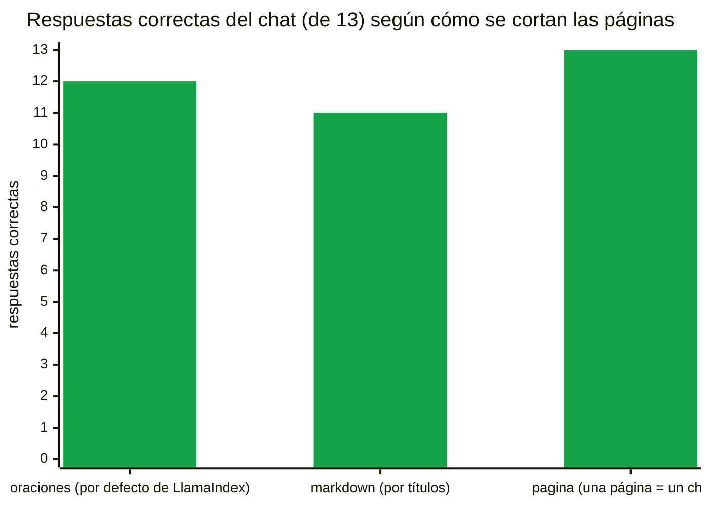

La primera versión del chat respondió bien que el resultado neto del comunicado coincide con el de los estados financieros, pero **inventó las unidades**: dijo "miles" y "pesos" cuando eran millones y miles. El dato estaba en el encabezado de la tabla, y el corte en chunks lo había dejado en otro pedazo. Probamos tres formas de cortar, las medimos con 13 preguntas verificadas a mano y ganó la más simple: **una página = un chunk**, con **13 de 13 respuestas correctas** y la mejor búsqueda (MRR 0,84). Este README explica cómo llegamos a cada número.

## Cómo funciona

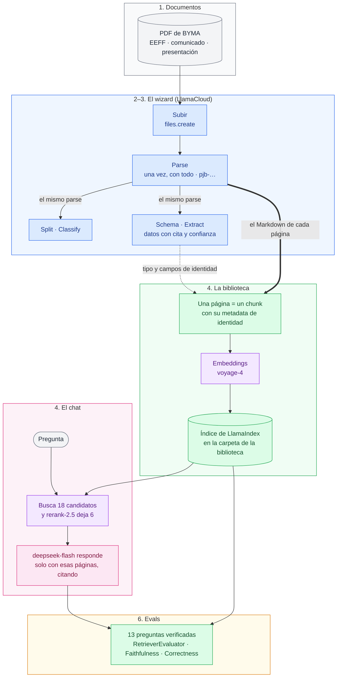

**Los colores dicen quién hace cada cosa** (el mismo código en todos los diagramas):
🔵 LlamaCloud (en la nube, con créditos) · 🟢 LlamaIndex (código abierto, en nuestro servidor) · 🟣 Voyage AI (embeddings y reranker) · 🌸 DeepSeek (el modelo que escribe) · ⚪ nuestro código y los datos.

| Etapa | Pregunta que responde | Resultado |
|---|---|---|
| **1. Documentos** | ¿Con qué probamos? | 3 PDF públicos de BYMA: 111 páginas con tablas, gráficos y texto legal |
| **2. Parse** | ¿Cómo se lee un PDF? | Markdown, tablas, gráficos como tablas, cajas por elemento y capturas. 15 créditos por página |
| **3. Split → Extract** | ¿Qué es y qué datos tiene? | Tipo con 100 % de confianza; datos con cita y caja en la página. Los campos obligatorios hacen inventar |
| **4. Biblioteca y chat** | ¿Cómo se conversa con varios documentos? | LlamaIndex arma el índice y el chat; Voyage busca; DeepSeek responde citando |
| **5. Chunking** | ¿Cómo conviene cortar? | Una página = un chunk: no parte las tablas y la cita por página es exacta |
| **6. Evals** | ¿Cómo sabemos que está bien? | 13 de 13 correctas y 13 de 13 fieles a los fragmentos, con las dos trampas incluidas |

## 1. Los documentos

Tres documentos públicos de BYMA sobre el mismo trimestre, elegidos **a propósito** porque cuentan lo mismo de tres formas distintas: el chat tiene que cruzarlos, y cada uno pone a prueba algo diferente.

| Documento | Páginas | Qué tiene | Qué pone a prueba |
|---|---:|---|---|
| `BYMA - EEFF 30-09-2026 - VF.pdf` | 86 | Estados financieros: balance, resultados, notas, firmas | Tablas largas que siguen en la página siguiente, cifras en **miles de pesos** |
| `BYMA Comunicado de Prensa - 3T26.pdf` | 10 | Texto y tablas resumen | Columnas **históricas** y **ajustadas por inflación**, cifras en **millones** |
| `Presentacion_de_Resultados-3T26.pdf` | 15 | Diapositivas con gráficos | Datos que solo están en gráficos |

Están en [`backend/data/samples/byma/`](backend/data/samples/byma/), junto con el [set de preguntas de los evals](backend/data/samples/byma/evals/preguntas.json).

## 2. Parse: el corazón

Todo empieza por leer el PDF. **Se parsea una sola vez, pidiendo todo lo que ofrece LlamaParse**, y los demás pasos reciben solo el ID de ese parse (`pjb-…`): no se vuelve a leer ni a pagar.

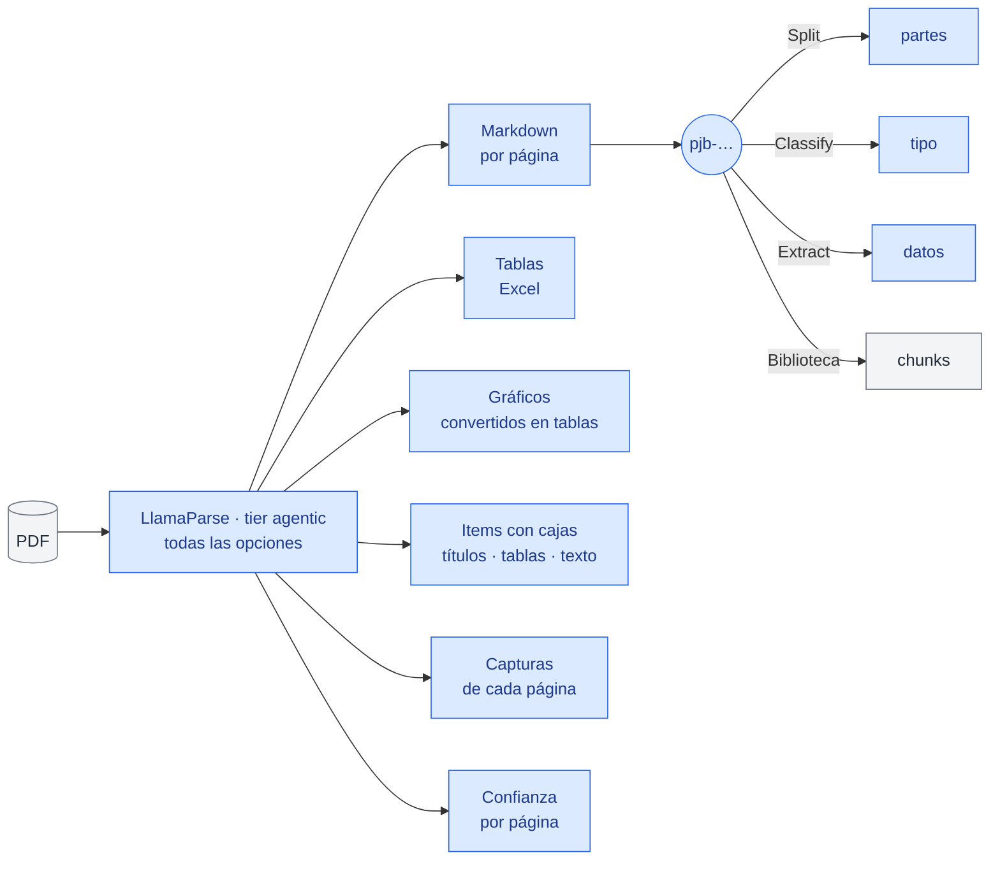

| Documento | Páginas | Créditos | Por página |
|---|---:|---:|---:|
| EEFF | 86 | 1.310 | 15,2 |
| Comunicado | 10 | 210 | 21 |
| Presentación | 15 | 585 | 39 |

- **Las páginas con gráficos cuestan más:** de 21 a 39 créditos contra 15 de una página de texto, porque el tier agentic los lee con IA.
- **El parse no es determinístico.** El mismo archivo, con la misma versión, dio otra confianza; y un parse anterior de la presentación **inventó los valores de un gráfico** (pág. 5: puso 1.350, 1.203, 1.457… donde el gráfico dice 250, 232, 973…) con una confianza de 0,85. Se detectó comparando contra la captura. **Los datos de gráficos hay que verificarlos contra la imagen.**
- **Las tablas que siguen en la página siguiente las une LlamaParse** (`merge_continued_tables`): en los EEFF unió 6, y cada una queda entera en su primera página. Esto importa en la sección 5.

## 3. Split, Classify, Schema y Extract

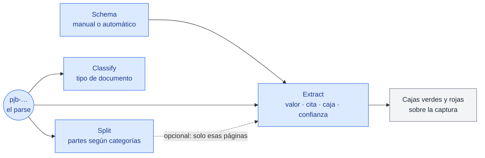

| Paso | Qué hace | Resultado en BYMA | Créditos |
|---|---|---|---|
| **Split** | Divide en partes según categorías editables | EEFF en 15 partes de 7 categorías (balance, resultados, notas…) | No los informa (la lista de precios dice 3 por página) |
| **Classify** | Elige el tipo con reglas editables | `estados_financieros`, `comunicado_de_prensa` y `presentacion`, con razonamiento | **0** sobre un parse |
| **Schema** | Define qué datos sacar: a mano o propuesto por el agente | Plantilla "Resultados trimestrales" de 11 campos | No los informa |
| **Extract** | Saca cada dato con su cita, su caja y su confianza | 11 de 11 en el comunicado, 92 % de confianza promedio | **15 por página** |

**El experimento de esta etapa: schema manual vs. automático.**

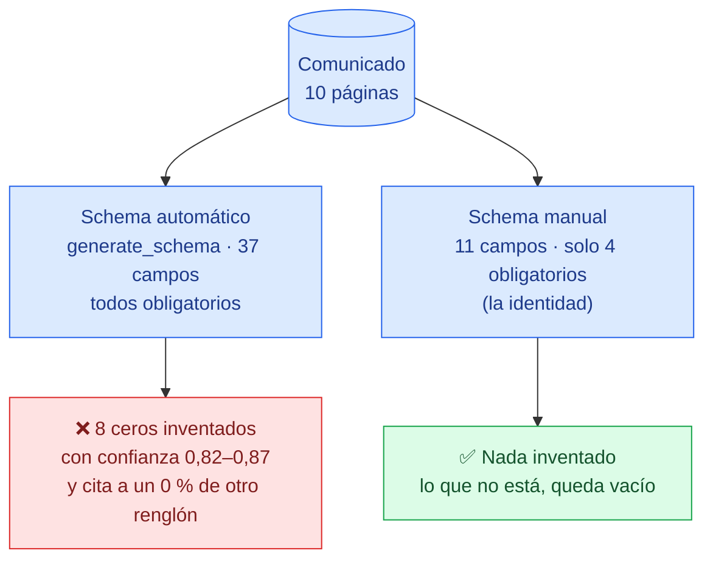

- **Un campo obligatorio obliga a Extract a devolver algo, aunque no exista.** El comunicado no tiene EBITDA ajustado por inflación, y como el schema automático lo obligaba, Extract devolvió 0.
- **Una cita válida y una confianza alta no garantizan el dato:** la cita apuntaba a un "0 %" real, pero del renglón "Mercado". Solo **la caja dibujada sobre la captura** mostró que era otro renglón.
- Por eso el wizard trae la opción **"solo identidad obligatoria"** y avisa cuando todos los campos son obligatorios. Con ella, en la presentación, el campo obligatorio `fecha_de_cierre` volvió **vacío** en vez de inventado: la presentación no dice esa fecha.

<p align="center">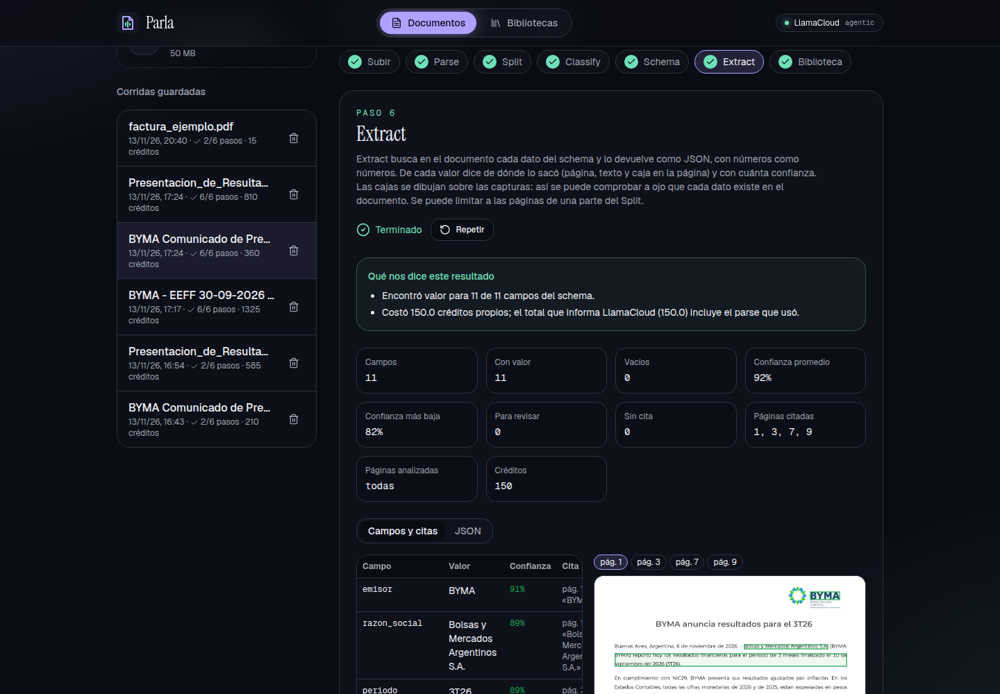</p>
<p align="center"><sub>El paso Extract con el comunicado: 11 de 11 campos con valor, la confianza de cada uno y la caja verde sobre la captura de la página citada.</sub></p>

## 4. Bibliotecas: quién hace qué

Una biblioteca junta documentos del wizard para **buscar y chatear con todos a la vez**. No se vuelve a parsear nada: se usa el Markdown que ya hizo LlamaParse.

| Paso | Quién lo hace | Dónde corre |
|---|---|---|
| Leer el PDF y pasarlo a Markdown por página | 🔵 **LlamaParse** (paso Parse del wizard) | En la nube, con créditos |
| Armar un documento por página con su metadata (tipo, emisor, período…) | ⚪ **Nuestro código** (`build_documents`) | Nuestro servidor |
| **Cortar en chunks** | 🟢 **LlamaIndex** (`build_nodes`; ver la sección 5) | Nuestro servidor |
| Convertir cada chunk en un vector | 🟣 **Voyage AI** (`voyage-4`), llamado por LlamaIndex | API de Voyage: devuelve el vector y no guarda nada |
| **Armar y guardar el índice** | 🟢 **LlamaIndex** (`VectorStoreIndex`), en JSON en la carpeta de la biblioteca | Nuestro servidor |
| Reordenar los candidatos | 🟣 **Voyage AI** (`rerank-2.5`) | API de Voyage |
| **Manejar el chat** (reescribir, juntar fragmentos, armar el prompt) | 🟢 **LlamaIndex** (`CondensePlusContextChatEngine`) | Nuestro servidor |
| Escribir la respuesta | 🌸 **DeepSeek** (`deepseek-flash`) | API de DeepSeek |
| Las instrucciones, guardar cada turno y medir | ⚪ **Nuestro código** | Nuestro servidor |

**Un turno de chat, de punta a punta:**

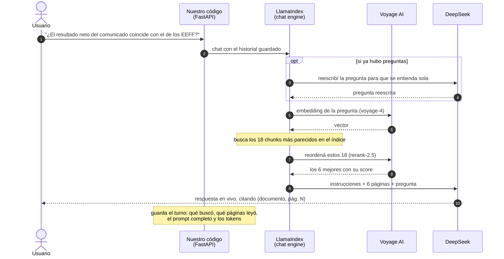

- **Cada turno queda auditado** en `chats/local/turno_N.json`, gracias a la instrumentación nativa de LlamaIndex: la consulta que se buscó de verdad, las páginas con su score, el prompt completo de cada llamada y los tokens (incluidos los de razonamiento).
- **Las instrucciones** piden responder solo con los fragmentos, decir que el dato no está cuando no está, citar documento y página y copiar los números con su unidad.
- **¿Por qué un motor local?** El índice de LlamaCloud necesita un plan pago (con el gratis responde 403). El motor de LlamaCloud también está escrito (`library.py`) y se elige con `LIBRARY_ENGINE`. LlamaParse no tiene embeddings propios, así que Voyage y DeepSeek entran por las **integraciones oficiales de LlamaIndex**.
- **Del wizard a la biblioteca:** el paso 7 del wizard suma la corrida a una biblioteca sin volver a parsear y sin gastar créditos. Los embeddings se calculan recién al sincronizar.

<p align="center">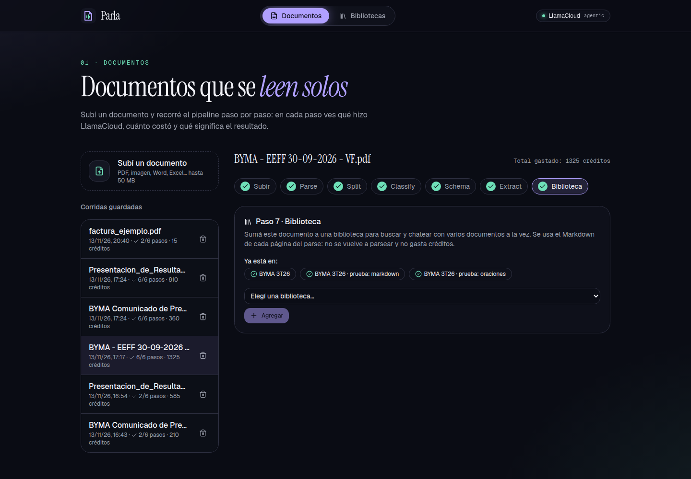</p>
<p align="center"><sub>El paso 7 con los EEFF: ya están en la biblioteca principal y en las dos de prueba.</sub></p>

## 5. Chunking: oraciones vs. markdown vs. página

Un vector que resume un texto muy largo mezcla demasiados temas, y uno muy corto pierde el contexto. Por eso se corta cada página en *chunks*. **Cómo se corta decide qué ve el modelo.** Probamos tres formas, todas nativas de LlamaIndex, con los mismos documentos, el mismo índice y las mismas preguntas.

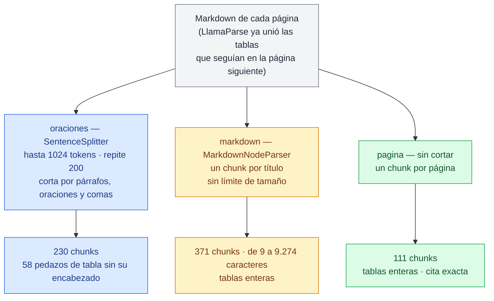

**El problema que lo disparó.** Con `oraciones`, la tabla de la pág. 3 del comunicado quedó partida: el encabezado (*"Millones de ARS · Histórico · Ajustado por inflación"*) en un chunk y los números en otro. El chat recibió los números sin las unidades y **las supuso**. La respuesta coincidía, pero la explicación era inventada.

| | oraciones | markdown | **pagina (ganador)** |
|---|---:|---:|---:|
| Chunks | 230 | 371 | **111** |
| Tablas partidas sin su encabezado | 58 | 0 | **0** |
| Búsqueda: MRR | 0,712 | 0,761 | **0,841** |
| Respuestas correctas (de 13) | 12 | 11 | **13** |
| Corrección promedio (de 1 a 5) | 4,77 | 4,62 | **5,00** |
| Tokens de DeepSeek de entrada (13 preguntas) | 126.594 | 190.442 | 252.183 |

- **Markdown mantiene las tablas, pero busca peor lo que cruza documentos.** Sus chunks de 9.000 caracteres "se parecen un poco a todo y mucho a nada": la tabla del comunicado quedó en el puesto 34 de la búsqueda por vectores, fuera de los 18 candidatos. Sin el comunicado, el chat comparó los EEFF consigo mismos.
- **Subir a 60 candidatos no cambió nada** en ninguna de las formas de cortar: el problema era el corte, no la cantidad.
- **La página gana porque respeta lo que ya hizo LlamaParse:** las tablas que unió entre páginas quedan enteras, con su encabezado, y la cita por página es exacta (las cajas sobre la captura siguen funcionando).
- **El precio:** el doble de tokens de DeepSeek por pregunta, porque se mandan páginas enteras. Con `deepseek-flash` siguen siendo centavos.
- **Lo que no resuelve:** un párrafo que sigue en la página siguiente queda en dos chunks. En BYMA no encontramos casos. Juntarlo sin perder la página sería código propio: no hay nada nativo.

Las tres bibliotecas se conservan a propósito, para que quede la trazabilidad: **"BYMA 3T26"** (la principal, con el corte por página), **"BYMA 3T26 · prueba: oraciones"** y **"BYMA 3T26 · prueba: markdown"**. La pantalla muestra el corte de cada una.

## 6. Evals: medir la búsqueda y las respuestas

LlamaCloud y Voyage no traen evals para RAG, pero el framework LlamaIndex sí, de forma nativa (`llama_index.core.evaluation`). No hizo falta sumar otro framework.

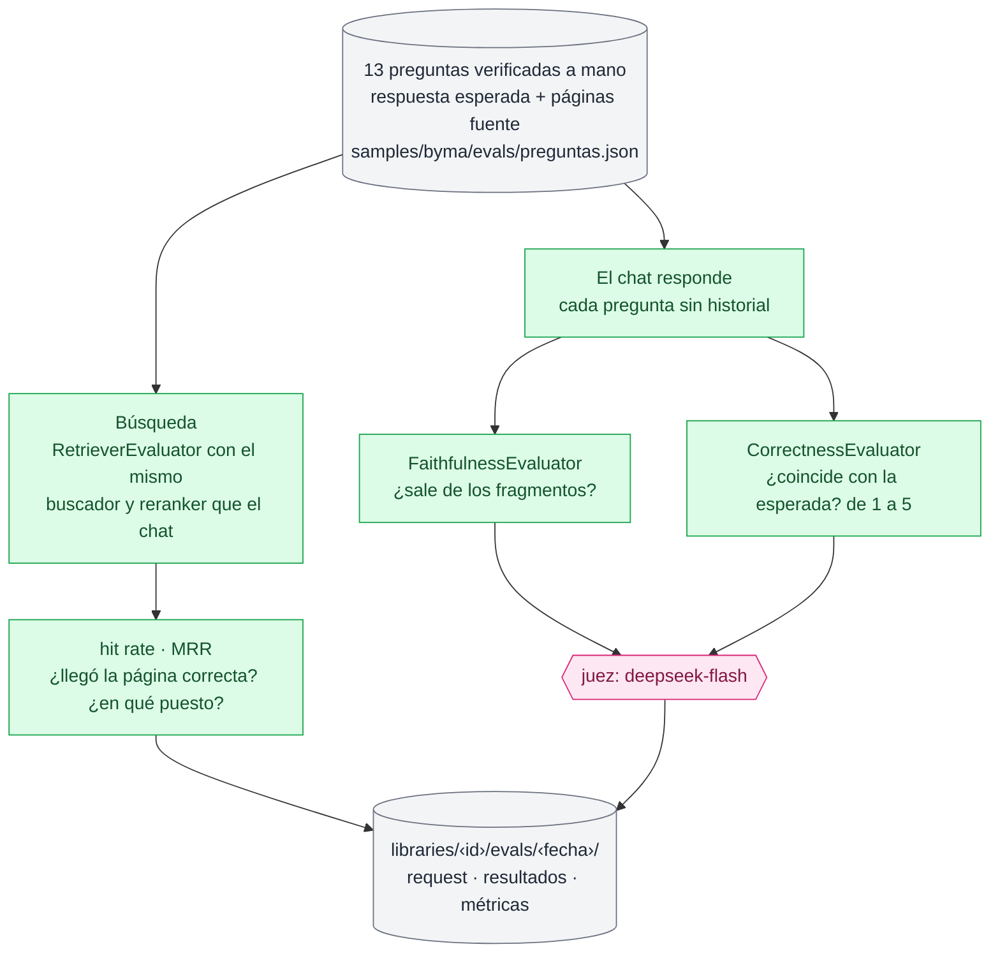

**El set de preguntas** tiene 7 datos (resultado neto ajustado e histórico, ingresos, EBITDA, Depositaria, resultado de 9 meses y Datos de Mercado), 1 comparación entre documentos, 1 de unidades, 1 de explicación, 1 de identidad y **2 trampas** (el 4T26 y la cantidad de empleados, que no están en los documentos).

| Pregunta | oraciones | markdown | pagina |
|---|:---:|:---:|:---:|
| ¿El resultado neto del comunicado coincide con el de los EEFF? | 4 | 2 | **5** |
| ¿En qué unidad están los estados financieros? | 5 | 5 | 5 |
| ¿Cuál fue el resultado neto del 4T26? (trampa) | 5 | 5 | 5 |
| ¿Cuántos empleados tiene BYMA? (trampa) | 5 | 5 | 5 |
| **Fieles a los fragmentos** | 13 de 13 | 13 de 13 | 13 de 13 |

Todas las preguntas, con su puntaje y la página encontrada, están en [`docs/resultados/`](docs/resultados/). En la app se ven en la pestaña **Evals** de cada biblioteca local, que también permite volver a correrlos:

<p align="center">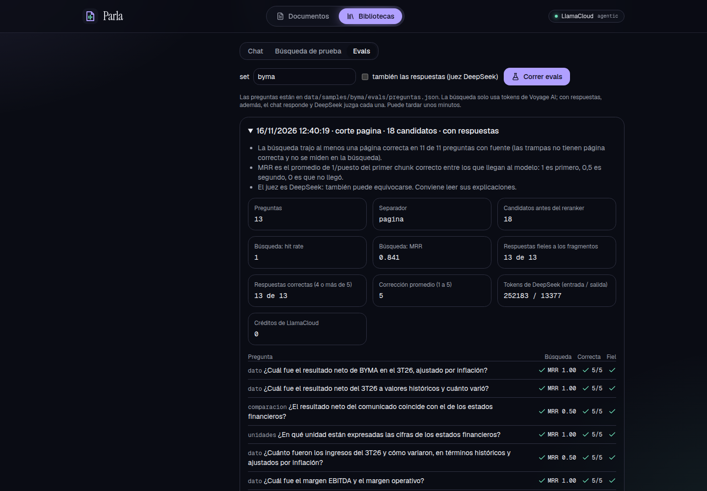</p>
<p align="center"><sub>La corrida de "BYMA 3T26" (corte por página): MRR 0,841, 13 de 13 respuestas correctas y fieles. Cada fila se abre con la respuesta, las páginas y la explicación del juez.</sub></p>

**El eval también encontró errores en el set.** Es lo más didáctico de esta etapa:

1. **Fuentes demasiado cortas.** *"¿En qué unidad están los EEFF?"* fallaba en las tres formas de cortar. No era el buscador: la frase *"Cifras expresadas en miles de pesos y en moneda constante"* está en **74 páginas**, y el set aceptaba solo una. Se ampliaron las fuentes a todas las páginas que tienen la respuesta.
2. **Una contradicción que no existía.** En la pág. 5 de la presentación, la tabla dice "Datos de Mercado 3T25 = 1.578" y el gráfico, 291. Lo cargamos como contradicción del documento. El chat con el corte por página citó la **pág. 9**, que lo explica: Market Data 1.286 + BYMADATA 291 = 1.578. Se verificó en la captura y se corrigió la pregunta.

> **El eval vale lo que vale el set.** Antes de creerle a una métrica, hay que revisar las preguntas y las fuentes contra los documentos.

## Qué aprendimos

1. **El parse es el corazón.** Se parsea una vez, completo, y todo lo demás sale de ahí. Pero no es determinístico: los datos de gráficos hay que verificarlos contra la captura.
2. **Una cita válida no garantiza el dato.** Los ceros inventados tenían cita a un "0 %" real; la respuesta de las unidades citaba bien las páginas. Lo que sirve es **ver la caja en la página** y medir con preguntas verificadas.
3. **Los campos obligatorios hacen inventar.** Con pocos obligatorios y la regla "vacío si no consta", Extract no inventó nada.
4. **Cómo se corta pesa más que cuántos candidatos se buscan.** Pasar de 18 a 60 candidatos no cambió nada; cambiar el corte llevó de 11–12 a 13 correctas.
5. **Lo más simple ganó.** Una página = un chunk respeta lo que ya hizo LlamaParse (las tablas unidas) y deja la cita exacta. Ni el corte por defecto de LlamaIndex ni el "inteligente" por títulos la superaron.
6. **Las trampas salieron bien siempre.** Con las instrucciones de responder solo con los fragmentos, el chat dijo "no está" en las dos preguntas trampa con los tres cortes.
7. **El eval también audita al set.** Dos de las fallas eran errores nuestros en las respuestas esperadas.

> **Ojo con leer estos números como definitivos.** Son 13 preguntas sobre tres documentos de un solo emisor; cada pregunta vale casi 8 puntos. El juez es un LLM (DeepSeek), que también puede equivocarse, y a veces explica en inglés. Markdown y oraciones se juzgaron con la versión vieja de una pregunta (la de Datos de Mercado); sin ella, oraciones saca 12 de 12, aunque con 4 en la que cruza documentos.

**Qué haríamos distinto o seguiríamos:** más preguntas, que no nombren al emisor y que crucen documentos; evaluar si llegan **todas** las fuentes de una pregunta y no solo una; probar `deepseek-v4-pro` como juez y como chat; y comparar contra el índice de LlamaCloud cuando haya un plan pago.

## Costos medidos

| Qué | Costo | Cómo se midió |
|---|---|---|
| Parse agentic con todas las opciones | 15 créditos por página; 21 a 39 en páginas con gráficos | `usage` de cada job |
| Split | No lo informa; la lista de precios dice 3 por página | — |
| Classify sobre un parse ya hecho | 0 | `expand=usage` |
| Schema (`generate_schema`, validar, guardar) | No lo informa | Conciliación con el panel |
| Extract agentic con citas y confianza | 15 créditos por página, sin importar cuántos campos | `extract_credits` |
| Índice de una biblioteca | 0 créditos; unos 184.000 tokens de Voyage (gratis hasta 200 millones) | Tokenizador de Voyage |
| Una pregunta al chat | 0 créditos; menos de un centavo de dólar de DeepSeek | Saldo de DeepSeek |
| Una corrida de evals con respuestas (13 preguntas) | 0 créditos; unos USD 0,02 de DeepSeek | Saldo de DeepSeek |

Cada llamada paga está en el **registro de créditos** de la [bitácora](docs/bitacora.md): 30 entradas, con su job, sus opciones y lo que costó.

## Las reglas del proyecto

1. **Solo lo nativo.** Nada que LlamaCloud, LlamaParse o LlamaIndex (con sus integraciones oficiales) no hagan de forma nativa. Si la plataforma no lo hace, se dice y se decide.
2. **Traer todo, medir e interpretar.** Cada paso pide toda la información, la guarda (`request.json`, `response.json`), la mide y la interpreta **solo con datos de la API**. Si la API no dice el motivo de algo, se dice así.
3. **Registrar todo para auditar.** Cada prueba, hallazgo y decisión va a la bitácora, en orden.
4. **Código simple**, con un comentario en español arriba de cada función que dice qué hace y por qué.
5. **Sin base de datos:** todo en carpetas, y **cada cosa en su carpeta**.
6. **Se conservan las pruebas**, para poder explicar por qué ganó lo que ganó.

Las reglas completas están en [CLAUDE.md](CLAUDE.md).

## Reproducir

**Lo que hace falta:** Python 3.11 con [`uv`](https://docs.astral.sh/uv/), Node.js y tres claves.

```bash
git clone https://github.com/javi2481/parla-rag.git
cd parla-rag/backend
cp .env.example .env      # completar las tres claves
uv sync
uv run uvicorn app.main:app --reload --port 8000

# en otra terminal (el proxy de Vite manda /api al backend)
cd frontend && npm install && npm run dev      # http://localhost:5173
```

| Clave | Para qué | Dónde se saca |
|---|---|---|
| `LLAMA_CLOUD_API_KEY` | El wizard | [cloud.llamaindex.ai](https://cloud.llamaindex.ai) |
| `VOYAGE_API_KEY` | Embeddings y reranker | [dashboard.voyageai.com](https://dashboard.voyageai.com). **Cargá un medio de pago:** sin tarjeta permite 3 pedidos y 10.000 tokens por minuto (los 200 millones gratis se mantienen) |
| `DEEPSEEK_API_KEY` | El chat y el juez de los evals | [platform.deepseek.com](https://platform.deepseek.com) |

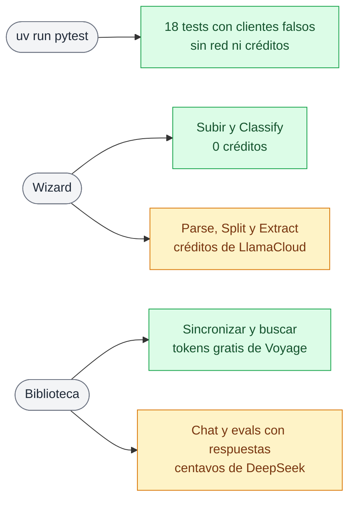

**Con Docker** (un solo contenedor: compila el frontend y lo sirve FastAPI junto con la API):

```bash
docker compose up --build -d     # http://localhost:8000
```

Las claves se leen de `backend/.env` al arrancar y nunca entran en la imagen; los datos quedan en el volumen `parla-rag-data`. La primera sincronización baja los datos de NLTK (necesita internet). Si la cuenta de LlamaCloud es de la región EU: `LLAMA_CLOUD_BASE_URL=https://api.cloud.eu.llamaindex.ai`.

**Las opciones de las bibliotecas** (en `.env`, todas con valor por defecto): `LIBRARY_ENGINE=local`, `LIBRARY_SPLITTER=pagina`, `LIBRARY_EMBED_MODEL=voyage-4`, `LIBRARY_RERANK_MODEL=rerank-2.5`, `LIBRARY_CHAT_MODEL=deepseek-flash` y `LIBRARY_CHAT_TOP_K=6`.

## Estructura del repositorio

```text
.
├── backend/
│   ├── app/
│   │   ├── main.py                    # arma la app y conecta las rutas
│   │   ├── core/                      # lo compartido: configuración, límites y runs/ (la carpeta-DB)
│   │   └── pipelines/documents/       # todo el pipeline (ver su README)
│   │       ├── pipeline.py            # el orden de los pasos: empezá a leer por acá
│   │       ├── steps/                 # un archivo por paso del wizard
│   │       ├── local_library.py       # bibliotecas con LlamaIndex + Voyage + DeepSeek (el motor que se usa)
│   │       ├── library_evals.py       # evals de las bibliotecas
│   │       └── library.py             # bibliotecas con el índice de LlamaCloud (plan pago)
│   ├── data/                          # la "base de datos" en carpetas
│   │   ├── samples/byma/              # los 3 PDF y evals/preguntas.json (van al repo)
│   │   ├── documents/runs/            # las corridas del wizard (no van al repo)
│   │   ├── documents/libraries/       # las bibliotecas: índice, chats, búsquedas y evals (no van al repo)
│   │   └── nltk/                      # datos para cortar oraciones (se bajan solos)
│   └── tests/                         # misma forma que app/
├── frontend/src/
│   ├── components/                    # wizard (stepper, visores, cajas sobre la página) y ui/
│   └── pipelines/documents/           # el wizard, un panel por paso y las bibliotecas
├── docs/
│   ├── estado.md                      # hecho, pendiente y roadmap
│   ├── bitacora.md                    # cada prueba, hallazgo y decisión, con el registro de créditos
│   ├── figuras/                       # capturas de la app para este README
│   ├── resultados/                    # los resultados de los evals, en CSV
│   └── …                              # el plan, el informe de la API y las verificaciones
├── CLAUDE.md                          # las reglas del proyecto
└── LICENSE
```

Cómo viajan los datos entre las carpetas:

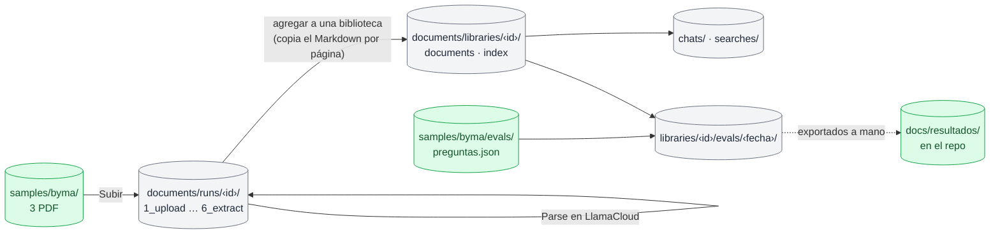

🟢 en el repo · ⚪ solo en la máquina (pesan mucho y traen links firmados temporales). **Fuente de verdad:** los números de este README salen de las corridas guardadas y están anotados en la bitácora y en `docs/resultados/`.

## La API, ruta por ruta

| Ruta | Qué hace | Escribe en | Costo |
|---|---|---|---|
| `POST /api/documents/runs` | Crea una corrida y sube el archivo | `runs/‹id›/1_upload/` | 0 |
| `POST /api/documents/runs/{id}/steps/{paso}` | Arranca un paso (`parse`, `split`, `classify`, `schema`, `extract`) | `runs/‹id›/‹n›_‹paso›/` | Créditos según el paso |
| `GET /api/documents/runs/{id}/steps/{paso}` | Consulta el job y, al terminar, guarda todo | ídem | 0 |
| `DELETE /api/documents/runs/{id}` | Borra la corrida, su archivo y todos sus jobs en LlamaCloud | — | 0 |
| `POST /api/documents/libraries` | Crea una biblioteca | `libraries/‹id›/run.json` | 0 |
| `POST /api/documents/libraries/{id}/documents` | Agrega una corrida (copia su Markdown por página) | `documents/` | 0 |
| `POST /api/documents/libraries/{id}/sync` | Arma el índice | `index/` · `syncs/` | Tokens de Voyage |
| `POST /api/documents/libraries/{id}/search` | Búsqueda de prueba, con filtros por metadata | `searches/` | Tokens de Voyage |
| `POST /api/documents/libraries/{id}/chat` | Un turno de chat, en vivo | `chats/local/` | Centavos de DeepSeek |
| `POST /api/documents/libraries/{id}/evals` | Evals: `conjunto`, `candidatos`, `respuestas` | `evals/‹fecha›/` | Voyage; DeepSeek si hay respuestas |

## La documentación

| Archivo | Qué tiene |
|---|---|
| [docs/estado.md](docs/estado.md) | **Para retomar el trabajo:** lo hecho, lo pendiente en orden y el roadmap |
| [docs/bitacora.md](docs/bitacora.md) | Cada prueba, hallazgo y decisión, en orden, con el registro de créditos |
| [docs/resultados/](docs/resultados/) | Los resultados de los evals, pregunta por pregunta |
| [backend/app/pipelines/documents/README.md](backend/app/pipelines/documents/README.md) | El pipeline por dentro: los pasos, los archivos que guarda cada uno y las bibliotecas |
| [docs/plan.md](docs/plan.md) | El diseño original y las fases |
| [docs/informe-fase-1.md](docs/informe-fase-1.md) | El relevamiento de la API de LlamaCloud |
| [docs/verificacion-1-parse.md](docs/verificacion-1-parse.md) · [docs/verificacion-2-fase3.md](docs/verificacion-2-fase3.md) | Las verificaciones con llamadas reales |

## Glosario rápido

| Término | Qué significa |
|---|---|
| **RAG** | Buscar primero los fragmentos relevantes y pasárselos al modelo para que responda con ellos |
| **Parse** | Leer un documento y convertirlo en texto estructurado (Markdown, tablas, cajas) |
| **Chunk** | Cada pedazo en que se corta el texto para buscarlo |
| **Embedding** | Un vector de números que representa el significado de un texto; textos parecidos quedan cerca |
| **Reranker** | Un modelo que relee los candidatos de la búsqueda y los ordena mejor que la comparación de vectores |
| **Metadata de identidad** | Los datos que dicen de qué es cada página (tipo, emisor, período), para filtrar la búsqueda |
| **Cita** | La página, el texto y la caja de donde salió un dato |
| **Confianza** | Lo seguro que dice estar el modelo de un dato. No es lo mismo que estar bien |
| **hit rate** | En cuántas preguntas llegó al modelo al menos una página correcta |
| **MRR** | El promedio de 1 / puesto de la primera página correcta: 1 es primera, 0,5 es segunda, 0 es que no llegó |
| **Faithfulness** | Si la respuesta sale de los fragmentos que recibió el modelo (si no, inventó) |
| **Correctness** | Qué tan parecida es la respuesta a la esperada, de 1 a 5 |
| **Juez** | El modelo que califica las respuestas en los evals |
| **Créditos** | La moneda de LlamaCloud: cada producto cobra por página procesada |

## Créditos

- [LlamaCloud / LlamaParse](https://cloud.llamaindex.ai): Parse, Split, Classify y Extract.
- [LlamaIndex](https://developers.llamaindex.ai/python/framework/): índice, chat engine, instrumentación y evals, con sus integraciones oficiales de [Voyage AI](https://docs.voyageai.com/) y [DeepSeek](https://api-docs.deepseek.com/).
- [BYMA](https://www.byma.com.ar/): los documentos públicos de resultados del 3T26 usados como ejemplo.

## Licencia

El código se distribuye bajo la [licencia MIT](LICENSE). Los documentos de BYMA de `backend/data/samples/` son públicos y pertenecen a su emisor; se incluyen solo como ejemplo.
