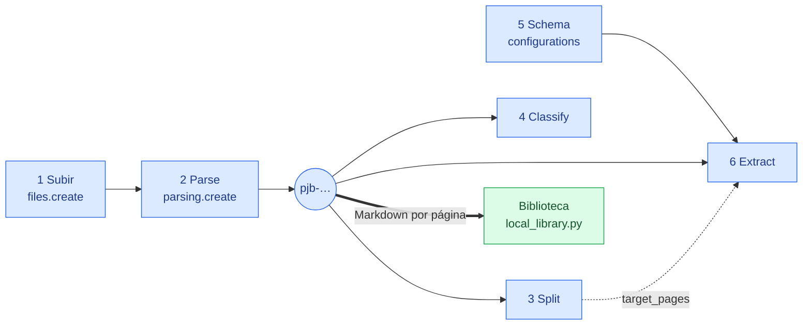

# Pipeline de documentos (LlamaCloud)

Un **wizard** que recorre un documento paso por paso con los productos de LlamaCloud.
En cada paso se guarda **todo** lo que devolvió la plataforma, se mide y se interpreta.

Regla: no se implementa nada que LlamaCloud no haga de forma nativa. Nuestro código solo
pide, guarda, cuenta y explica.

## El flujo



El documento se parsea **una vez**: los pasos siguientes reciben solo el ID del parse (`pjb-…`).

| Paso | Archivo | Qué hace | Producto de LlamaCloud | Créditos |
|---|---|---|---|---|
| 1 | `steps/s1_upload.py` | Sube el archivo y guarda una copia. Solo controla el tamaño. | `files.create` | 0 |
| 2 | `steps/s2_parse.py` | Lee el documento pidiendo **todo**: Markdown, texto, items con cajas, confianza por página, tablas en Excel, gráficos convertidos en tablas, capturas de página y 3 salidas extra. | `parsing.create` / `get` | los informa |
| 3 | `steps/s3_split.py` | Divide el documento en partes según categorías editables. | `split.create` / `get` | no los informa |
| 4 | `steps/s4_classify.py` | Elige el tipo de documento según reglas editables, con confianza y razonamiento. | `classify.create` / `get` | 0 sobre un parse |
| 5 | `steps/s5_schema.py` | Arma el schema: manual (tabla, plantilla o JSON) o automático (lo propone el agente). Lo valida y lo guarda con citas, confianza y tier agentic. | `extract.generate_schema`, `validate_schema`, `configurations` | no los informa |
| 6 | `steps/s6_extract.py` | Saca los datos del schema con la cita (página, texto, caja) y la confianza de cada uno. Puede limitarse a una parte del Split. | `extract.create` / `get` | los informa (`extract_credits`) |

Cada paso tiene:
- `EXPLICACION`: el texto para la clase.
- `start()`: arranca el job en LlamaCloud (Schema responde en el momento y no tiene `check()`).
- `check()`: consulta el job y, cuando termina, guarda todo.
- `summarize()`: arma las métricas y la interpretación, solo con lo que devolvió la API.
- `DEFAULTS` (Split, Classify, Schema): las opciones con las que arranca el editor del wizard.

`steps/jobs.py` tiene lo que comparten los pasos con job: consultar el estado y leer las opciones.

**Configuraciones nativas:** Parse (`parse_v2`), Split (`split_v1`), Classify (`classify_v2`) y el schema (`extract_v2`)
se guardan en `configurations` de LlamaCloud. LlamaCloud crea una versión nueva cada vez que se guarda con el mismo nombre.

## Repetir un paso

Repetir un paso no borra nada:
- la carpeta de la ejecución anterior se mueve a `historial/<carpeta>_<fecha>`;
- los pasos siguientes vuelven a pendiente (usaban el resultado anterior) y su carpeta también pasa al historial;
- el estado anterior de cada paso (con su `job_id`) queda en `run.json`, en la lista `historial`.

Al borrar una corrida se borran en LlamaCloud el archivo y **todos** los jobs, incluso los del historial.
Las configuraciones no se borran: son plantillas que pueden usar otras corridas.

## Dónde se guarda

Cada corrida es una carpeta en `backend/data/documents/runs/<id>/` (ver `app/core/runs/store.py`):

```
run.json        estado de cada paso, IDs de LlamaCloud, créditos e historial
1_upload/       original.pdf · request.json · response.json · metrics.json
2_parse/        request.json · configuration.json · response.json · document.md · text.txt · items.json
                metadata.json · forms.json · job_metadata.json · tables.xlsx · grounded_items.jsonl
                images/ · archivos/ · metrics.json
3_split/        request.json · configuration.json · response.json · segments.json · metrics.json
4_classify/     request.json · configuration.json · response.json · result.json · metrics.json
5_schema/       request.json · generated.json (solo automático) · schema.json · validation.json
                configuration.json · metrics.json
6_extract/      request.json · response.json · result.json · metadata.json · fields.json · boxes.json · metrics.json
historial/      las ejecuciones anteriores de cada paso
```

`request.json` es lo que se le pidió a LlamaCloud y `response.json`, su respuesta completa.
El resto son partes de esa respuesta separadas para leerlas fácil:
- `fields.json`: cada campo de Extract con su valor, confianza y citas (los que LlamaCloud no devolvió figuran como vacíos).
- `boxes.json`: una caja por renglón, lista para dibujar sobre la captura de su página (en puntos de la página, por ejemplo 612 × 792).

## Los archivos

| Archivo | Para qué |
|---|---|
| `pipeline.py` | La lista ordenada de pasos (**empezá a leer por acá**) |
| `steps/` | Un archivo por paso, más `jobs.py` |
| `router.py` | Rutas HTTP: `/api/documents/runs/...` |
| `settings.py` | API key, región, tier y versión de Parse, máximos |
| `client.py` | Crea el cliente de LlamaCloud |
| `errors.py` | `DocumentError`: errores con mensaje para el usuario |
| `library_router.py` | Rutas HTTP de las bibliotecas: `/api/documents/libraries/...`. Elige el motor de cada biblioteca |
| `local_library.py` | Bibliotecas con el motor local: LlamaIndex + Voyage AI + OpenAI (**el que se usa**) |
| `library_evals.py` | Evals de las bibliotecas locales: búsqueda y respuestas, con lo nativo de LlamaIndex |
| `library.py` | Bibliotecas con el índice de LlamaCloud (necesita un plan pago; con el gratis da 403) |

## Bibliotecas

Una biblioteca junta corridas del wizard para **buscar y chatear con todas a la vez**. Los dos motores tienen las mismas funciones
(`create_library`, `add_document`, `remove_document`, `start_sync`, `check_sync`, `search`, `chat_turn`, `delete_library`)
y devuelven lo mismo, así la pantalla no cambia. Cada biblioteca guarda en `run.json` con qué motor se creó (`engine`);
las nuevas usan `LIBRARY_ENGINE` del `.env` (`local` por defecto).

### Motor local (`local_library.py`)

```
agregar     copia el Markdown de cada página del parse (2_parse/response.json) a documents/<corrida>.json,
            con la metadata de identidad: el tipo de Classify y los campos obligatorios del schema de Extract
sincronizar una página = un Document de LlamaIndex → build_nodes corta según el separador de la biblioteca
            → VectorStoreIndex con embeddings voyage-4 → index/
buscar      voyage-4 trae top_k × 3 candidatos → rerank-2.5 deja los top_k → searches/<fecha>.json
chatear     CondensePlusContextChatEngine: gpt-5-nano reescribe la pregunta si hay historial,
            se busca como arriba (6 páginas) y gpt-5-nano responde en vivo citando documento y página
            → chats/local/turno_N.json
```

- **No se vuelve a parsear nada:** se usa el parse que ya hizo el wizard.
- **La metadata** `corrida` y `pagina` no entra en el embedding (son IDs); `corrida` tampoco se le pasa al modelo.
- **Cada turno de chat guarda todo** gracias a la instrumentación nativa de LlamaIndex (`TurnRecorder`): la consulta que se buscó de verdad (`RetrievalEndEvent`), cada llamada al modelo con su prompt completo y sus tokens (`LLMChatEndEvent` para la respuesta, `LLMCompletionEndEvent` para la reescritura), las páginas que leyó el modelo y los eventos que vio la pantalla.
- **NLTK** (con el que LlamaIndex corta oraciones) se baja a `data/nltk/` con permisos privados: se niega a leer carpetas que otros usuarios pueden modificar y los hardlinks que deja `uv` en `.venv`.
- **Errores de Voyage:** el límite por minuto responde 429 con la explicación; otros errores, 502.
- **El corte en chunks** (`LIBRARY_SPLITTER`, y cada biblioteca guarda el suyo en `splitter`):
  - `pagina` (por defecto): una página = un chunk (`TextNode`, porque el reranker de Voyage no acepta `Document`);
  - `oraciones`: `SentenceSplitter`, 1024 tokens con 200 de solapamiento;
  - `markdown`: `MarkdownNodeParser`, un chunk por título.

  `pagina` ganó en los evals (MRR 0,84 y 13 de 13 respuestas correctas): ver el [README principal](../../../../README.md#5-chunking-oraciones-vs-markdown-vs-página).
- **El chat engine** se arma en `make_chat_engine`, que usan el chat y los evals, así los evals miden exactamente el mismo chat.
- **Modelos y opciones** (`settings.py`): `LIBRARY_EMBED_MODEL=voyage-4`, `LIBRARY_RERANK_MODEL=rerank-2.5`, `LIBRARY_CHAT_MODEL=gpt-5-nano`, `LIBRARY_CHAT_TOP_K=6`.

### Evals (`library_evals.py`)

`POST /libraries/{id}/evals` con `conjunto` (el set de `data/samples/<conjunto>/evals/preguntas.json`), `candidatos` y `respuestas`:

- **Búsqueda:** `RetrieverEvaluator` con `hit_rate` y `mrr`, con el mismo buscador y el mismo reranker que el chat (`node_postprocessors`). Un chunk es correcto si es de una página fuente de la pregunta.
- **Respuestas** (si `respuestas` es `true`): el chat responde sin historial y `gpt-5-nano` sin streaming (`make_judge_llm`) hace de juez con `FaithfulnessEvaluator` y `CorrectnessEvaluator`.
- Cada corrida queda en `evals/<fecha>/`: `request.json`, `resultados.json` y `metrics.json`.

### Motor de LlamaCloud (`library.py`)

Un directorio (`beta.directories`) con su índice (`indexes`), que parsea con nuestra configuración completa (`product_config_id`).
Agregar usa el mismo `file_id` de la corrida (`unique_id` = la corrida). Al sincronizar mide con `parsing.list` si LlamaCloud volvió a parsear.
La búsqueda es `retrieval.retrieve` y el chat, `chat.stream` reenviado en vivo y guardado con `chat.retrieve` y `get_summary`.
**Con el plan gratis, crear el directorio responde 403.** Si algo falla a mitad de camino, se borra lo creado.

### Dónde se guarda una biblioteca

```
data/documents/libraries/<id>/
├── run.json                 nombre, motor, corte, modelos, documentos con su metadata, needs_sync, estado del sync
├── documents/<corrida>.json el texto de cada página que se indexó (motor local)
├── index/                   el índice de LlamaIndex (motor local)
├── syncs/<fecha>/           las métricas de cada sincronización
├── searches/<fecha>.json    cada búsqueda con sus resultados
├── chats/<sesión>/turno_N.json cada turno de chat
├── evals/<fecha>/           cada corrida de evals: request.json · resultados.json · metrics.json
└── historial/               los índices anteriores
```
